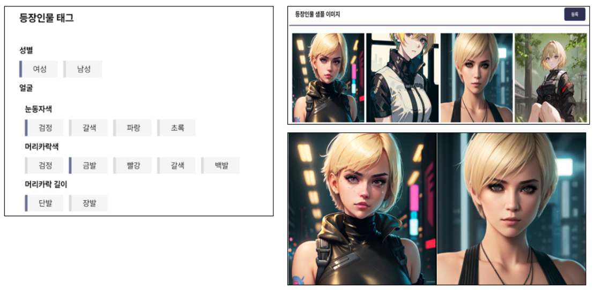
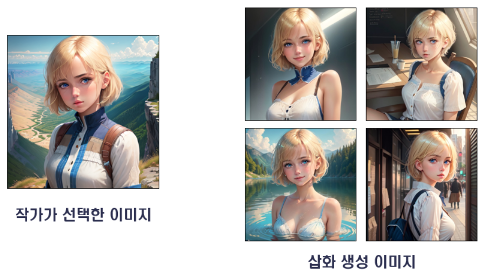
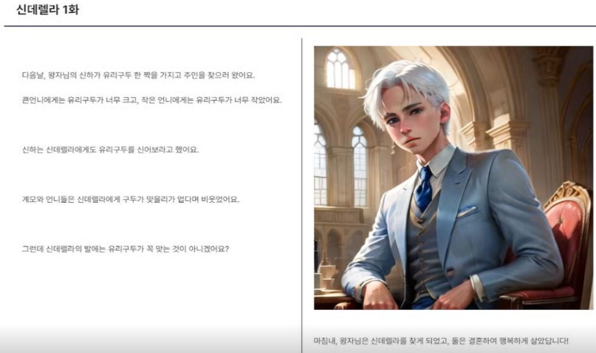

## Context

- Web novels often include illustrations of characters, either on the cover or within the text. These illustrations are typically outsourced to artists to ensure consistent character designs.
- However, communication issues between the author and the illustrator can lead to several challenges:
    - Time and cost inefficiencies
    - Failure to capture the character as envisioned by the author
    - Lack of immediate reflection of the author's feedback
    - Limited to the illustrator's particular drawing style
- To address these issues, this project aims to build an AI service that provides consistent character illustrations for web-novel platforms, establishing a stable system to solve the above problems.
    - The image generation model used is the **Latent Diffusion Model (LDM)**.
    - In this project, I (Junseo Park) focused on developing the AI model and server infrastructure.

## Problem

- LDM generates entirely different characters even with minor text changes, despite having a fixed seed value.
- A personalization methodology is required to create characters that remain consistent despite variations in text input.
- Assigning a separate model for each character is cost-inefficient. A single model must be capable of generating all characters within the same style.

## Proposed Method

The generation process is as follows:

1. The author selects a model (RevAnimate, DreamShaper, Pastelboys, Counterfeit) that can generate images in two styles (Midjourney-like or anime) to match the story's characters.
2. After selecting tags corresponding to the character, the author generates an image.
3. Once the desired character is generated, the author selects the character.
4. Since a single image is insufficient for training, $20$ images with various backgrounds, expressions, and angles are generated based on a prompt template.
    - To maintain character consistency, the original prompt is preserved with slight modifications, e.g., `{original prompt}, ((upper body)), in the mountain, looking at viewer`
5. The $20$ images are used to train the model with DreamBooth, a process that takes about $30$ minutes.
6. The author can then generate consistent character illustrations as needed.

- To provide consistent and personalized characters, [DreamBooth](https://arxiv.org/abs/2208.12242) is utilized:
    - **DreamBooth** is a personalization methodology that binds a pseudo word to a subject. Each character is mapped to a unique pseudo word (e.g., `zxw`), allowing multiple characters to be bound to a single model.
- The proposed service offers the following benefits:
    - Resolves time and cost inefficiencies
    - Generates characters as envisioned by the author
    - Simplifies the process with convenient tag-based generation
    - Immediately reflects the author's feedback
    - Enables image generation within ~$30$ seconds
    - Offers diverse image styles
    - Provides consistent character illustrations

## Results

By integrating a stable AI service into the web-novel platform, authors can now generate illustrations more flexibly and conveniently.

