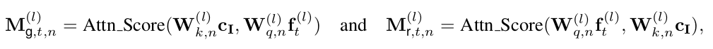
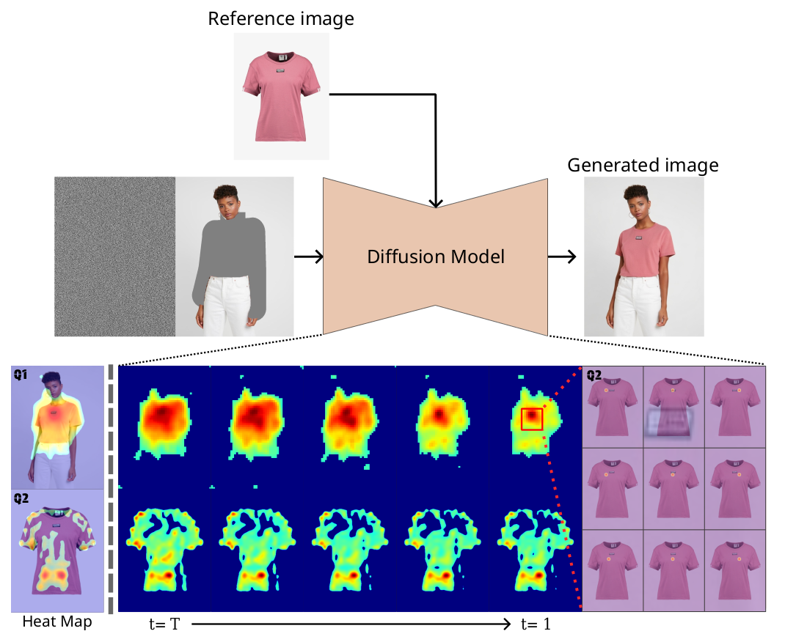
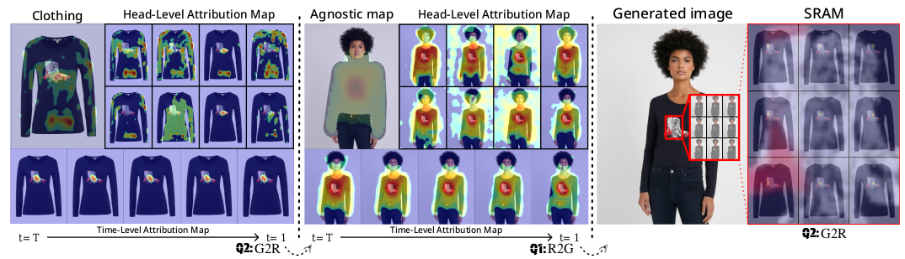
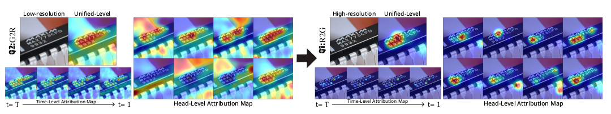
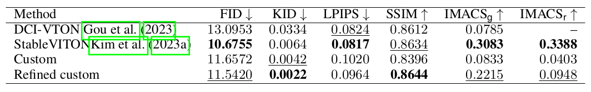
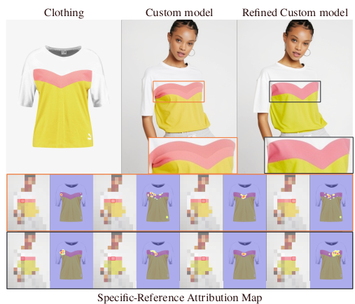

## Context

- Large-scale diffusion models have achieved significant advancements in image generation, particularly through cross-attention mechanisms.
- While cross-attention has been extensively studied in text-to-image tasks *(e.g., DAAM)*, its interpretability in image-to-image (I2I) diffusion models remains underexplored. To address this, we introduce Image-to-Image Attribution Maps ($\text{I}^{2}\text{AM}$).

## Problem

- The interpretability of I2I diffusion models is insufficiently explored.
- Applying text-to-image attribution/attention methods to I2I models often results in uninterpretable maps due to the contextual continuity of reference images *(vs. DAAM)*.

## Proposed Method

- We propose a bidirectional attribution analysis guided by two key research questions:
    - **Q1**: "Which regions of the generated image are most influenced by the reference image?" — exploring how the model utilizes the reference image during generation.
    - **Q2**: "Which parts of the reference image contribute most to the generated image?" — assessing how well the model captures and transfers critical details from the input.

- $\text{I}^{2}\text{AM}$ aggregates cross-attention scores across time steps, attention heads, and layers to provide insights into feature transfer between images:
    - **ULAM** (Unified-Level Attribution Map): integrates time, head, and layer scores to reveal overall trends.
    - **TLAM** (Time-Level Attribution Map): tracks the image generation process over time.
    - **HLAM** (Head-Level Attribution Map): analyzes attention score distributions across heads, highlighting diverse information capture.
    - **LLAM** (Layer-Level Attribution Map): explains how input features are processed and transformed at each layer, guiding model performance improvement.
    - **SRAM** (Specific-Reference Attribution Map): highlights regions in the reference image contributing to specific patches in the generated image.

## Results

- The top attribution map shows how different areas of the generated image are influenced by the reference image **(Q1)**. Conversely, the bottom map demonstrates how different regions of the reference image contribute to the generation process **(Q2)**, and the right map illustrates which reference information was extracted during the generation of that cell.

- $\text{I}^{2}\text{AM}$ demonstrates effectiveness across object detection, inpainting, and super-resolution tasks, successfully identifying key regions critical to output generation even in complex scenes.

- We also introduce the **Inpainting Mask Attention Consistency Score (IMACS)**, a novel metric that evaluates alignment between attribution maps and inpainting masks, showing strong correlation with existing performance metrics.

- Extensive experiments validate that $\text{I}^{2}\text{AM}$ supports model debugging and refinement, enhancing both the performance and interpretability of I2I models.

