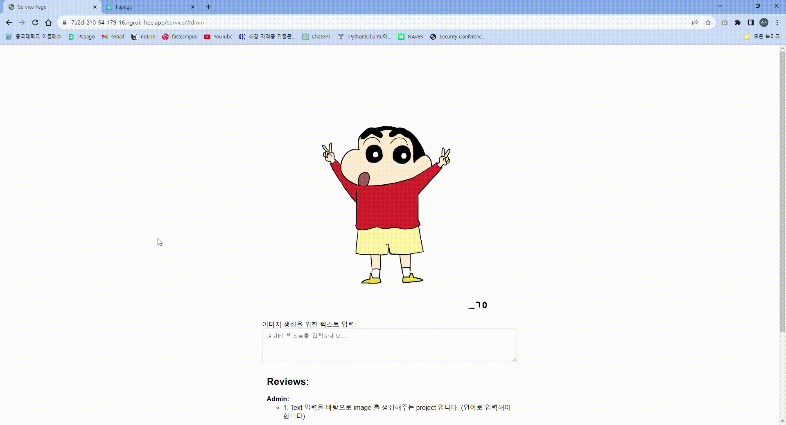

## Context

- The Latent Diffusion Model (LDM) has brought innovation to reliable image generation. Nevertheless, the inherently slow sampling process of diffusion models hinders real-time generation, negatively impacting user experience.
- Efforts to accelerate LDM generally fall into two categories:
    1. Utilizing advanced ODE solvers such as DDIM and DPM-Solver, which drastically reduce the $1{,}000$ time steps of DDPM.
    2. Distilling LDM.

## Problem

- The slow generation speed of traditional LDMs makes it challenging to satisfy users.
- Deploying a site to test user satisfaction requires significant time and resources.

## Proposed Method

- Introducing LCM-LoRA into an LDM ([SDXL](https://arxiv.org/abs/2307.01952)) to enable near real-time image synthesis:
    - The recently introduced [Latent Consistency Model (LCM)](https://arxiv.org/abs/2310.04378), inspired by the [Consistency Model (CM)](https://arxiv.org/abs/2303.01469), allows CM to be applied in latent space.
        - It can map any point on the ODE trajectory to its origin.
        - This enables efficient synthesis of high-resolution images with as few as $1$ to $4$ time steps.
    - LCM-LoRA acts as an adapter that can be attached to existing LDMs, reducing training costs.
- Building a website using Flask and ChatGPT.

## Results

- As demonstrated in the demo video on [GitHub](https://github.com/qkrwnstj306/Text-to-Image-Toy-Project/), the model generates images in response to user text input in near real time.
- Although not perfectly real-time due to communication delays between the server and the user and the time required to save images, the experience is significantly faster and more satisfying than before.
    - Feedback was collected from acquaintances to evaluate user satisfaction.
