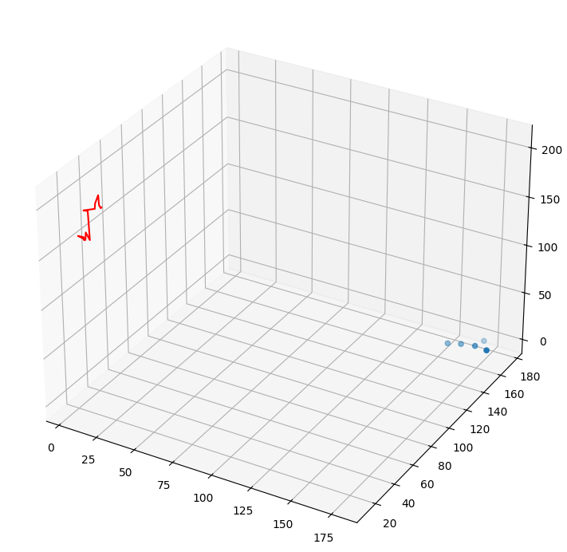
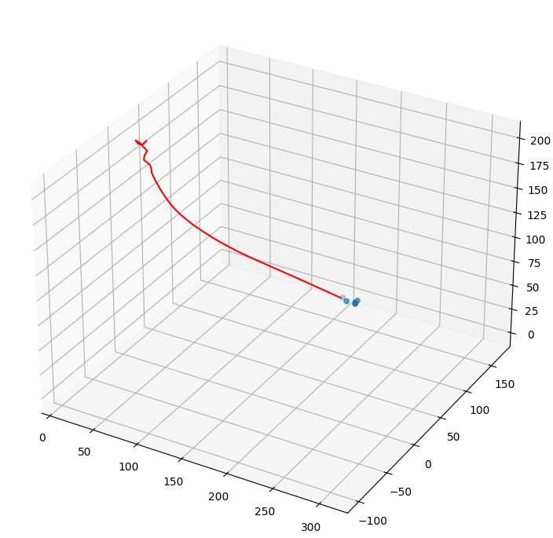
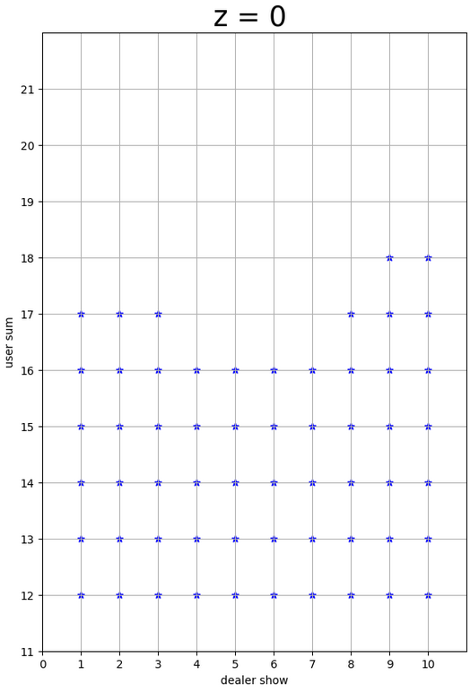
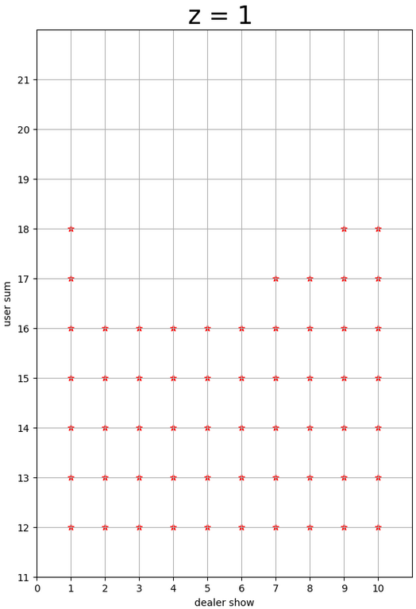

## Algorithm Test

- Basic RL algorithms were implemented and tested in the OpenAI Gym environment.
- The implemented algorithms are: `DQN`, `DDQN`, `Dueling DQN`, `DDQN + Dueling`, `PPO`, `A2C`, `A3C`.

## UAV with DDPG

### Motivation

- A paper presented an experiment where a UAV uses the received signal strength as a reward and employs reinforcement learning (DDPG) to approach the user.
- This project implements that experiment directly.

### Environment

- The UAV must reach the user.
- The starting position of the UAV is fixed at $(20, 20, 200)$.
- $K$ users (default: $5$) are generated at random positions `(rd.randint(150, 180), rd.randint(150, 180), 0)`.
- The DDPG algorithm is used, and the reward is based on the received signal strength between the user and the UAV.
- The network is implemented as a simple DNN.
- Each episode ends after $60$ steps.

<div class="figure-row">
  <figure><figcaption>Before training</figcaption></figure>
  <figure><figcaption>After training</figcaption></figure>
</div>

## Blackjack with TD vs. MC

- TD/MC prediction and control.
- The results vary depending on how the ace is counted.
    - Areas marked with a star represent *"hit,"* while the unmarked areas represent *"stand."*

<div class="figure-row">
  <figure><figcaption>Ace counted as 1</figcaption></figure>
  <figure><figcaption>Ace counted as 11</figcaption></figure>
</div>

## Unity with PPO

- Unity ML-Agents allows various RL algorithms to be applied to environments created with Unity.
- A car-racing environment was created, and PPO was applied to test whether the agent could complete the race.
- The configuration is as follows:

```yaml
behaviors:
  ArcadeDriver:
    trainer_type: ppo
    hyperparameters:
      batch_size: 1024
      buffer_size: 204800
      learning_rate: 0.0003
      beta: 0.005
      epsilon: 0.2
      lambd: 0.95
      num_epoch: 7
      learning_rate_schedule: linear
    network_settings:
      normalize: true
      hidden_units: 256
      num_layers: 2
      vis_encode_type: simple
    reward_signals:
      extrinsic:
        gamma: 0.995
        strength: 1.0
    keep_checkpoints: 200
    max_steps: 100000000
    time_horizon: 32
    summary_freq: 10000
    checkpoint_interval: 50000
```

<video controls preload="metadata" poster="/assets/img/posts/rl_1_thumbnail.jpg">
  <source src="/assets/img/posts/rl_1.mp4" type="video/mp4">
</video>

## Dodge Game

### Environment

- **Action**: move left or right
- **Termination**: the episode ends when the agent is hit by a ball
- **Reward**: $-0.01$ per time step, $+1$ for a small ball, $+10$ for a large ball
- **Base network**: MLP
- **Algorithms tested**: `DQN`, `A2C`, `DDPG`, `A3C`, `PPO`, `PPO + RNN`, `PPO + LSTM`, `DDQN`
- **Main result**: the task was easy, so the simple value-based methods (DQN, DDQN) performed best.

| Method | # of layers | Accelerated episode | Best score | Episode of best score | Avg. score ($\times 10^2$) |
|:--|:-:|:-:|:-:|:-:|:-:|
| DQN | 4 | 400 | 1578 | 178 | 150 |
| DQN with CNN | 4 | – | – | – | – |
| DDQN | 4 | 400 | **1729** | 299 | 160 |
| PPO | 5 | 600 | 173 | 200 | 11 |
| PPO with RNN | 5 | – | 45 | 100 | 11 |
| PPO with LSTM | 5 | 5000 | 140 | 205 | 24 |
