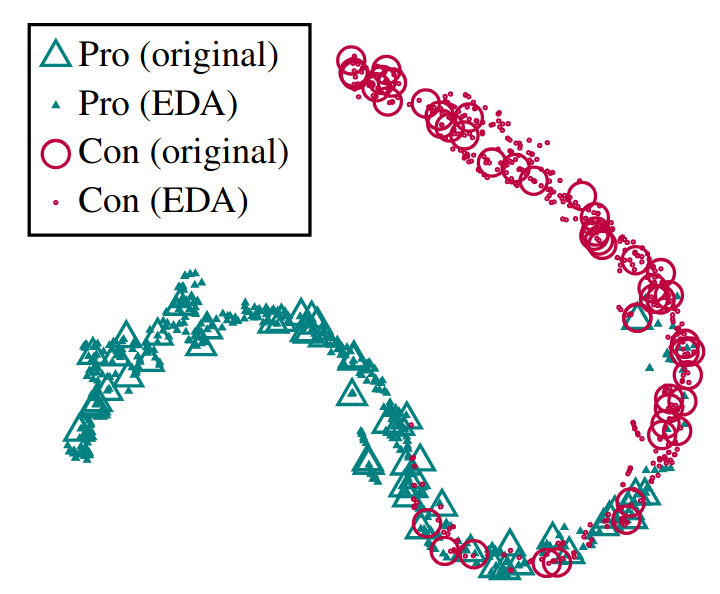
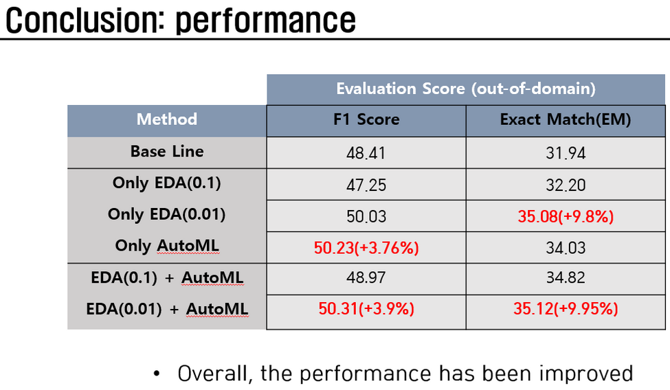

## Context

- The goal of this project is to build a robust Question Answering (QA) model that uses DistilBERT (a lightweight version of BERT) trained on in-domain datasets (SQuAD, NewsQA, Natural Questions) and performs well on unseen out-of-domain datasets (DuoRC, RACE, RelationExtraction).
    - **Train dataset**: $242{,}304$ (SQuAD, NewsQA, Natural Questions)
    - **Validation dataset**: $38{,}888$ (SQuAD, NewsQA, Natural Questions)
    - **Test dataset**: $721$ (DuoRC, RACE, RelationExtraction)
- The evaluation metrics are F1 score and Exact Match (EM).
    - Baseline (DistilBERT) — **F1**: $48.41$, **EM**: $31.94$

## Problem

- Developing a novel and groundbreaking methodology within a limited timeframe (1 month) is challenging.
- Therefore, we focused on simple and intuitive approaches to improve performance.

## Proposed Method

- **Data augmentation** ([EDA: Easy Data Augmentation](https://arxiv.org/abs/1901.11196))
    - Augmenting text data is a challenging task.
        - EDA, initially proposed for classification tasks, maintains the data distribution while augmenting text.
        - However, it is not directly suitable for QA tasks, so we modified it as follows:
            - Preserve case sensitivity.
            - Keep answer words intact and modify only the remaining words.

<figure>
  
  <figcaption>EDA-augmented sentences stay close to the original data distribution (figure from the EDA paper).</figcaption>
</figure>

> **EDA techniques**
>
> - Synonym Replacement (SR): replace $n$ randomly selected words (excluding stop words) with their synonyms.
> - Random Insertion (RI): choose a synonym of a randomly selected word (excluding stop words) and insert it into a random position in the sentence.
> - Random Swap (RS): randomly pick two words in the sentence and swap their positions.
> - Random Deletion (RD): delete words in the sentence with probability $p$.

- **AutoML** — we explored various hyperparameters to optimize the model:
    - LR scheduler: None, LambdaLR, MultiplicativeLR, StepLR, CosineAnnealingWarmUpRestarts
    - Optimizer: None, RMSprop, Adam, AdamW, SGD
    - Learning rate: $[2\times10^{-5}, 2\times10^{-4}]$
    - Batch size: $\{16, 32, 64\}$
    - Epochs: $[2, 5]$
    - Trained parameters: last layer vs. + last transformer block vs. full fine-tuning

## Results

- **EDA**
    - An augmentation probability of $p = 0.1$ (10%) caused instability.
    - A lower probability, $p = 0.01$ (1%), contributed to more stable performance improvements.
- **AutoML**
    - Both the SGD optimizer and partial training consistently degraded performance, so they were excluded.
- **Final results** — as shown in the table below, the performance improved significantly:
    - **F1 score**: $50.31$ (baseline: $48.41$)
    - **Exact Match**: $35.12$ (baseline: $31.94$)

