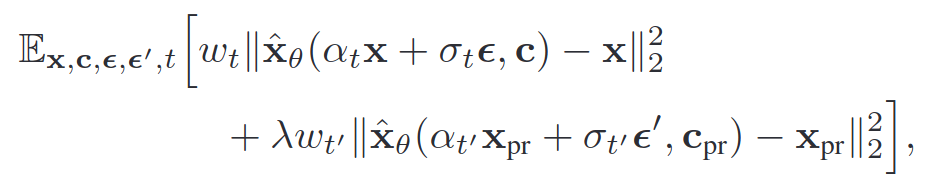
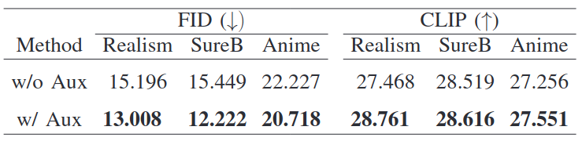
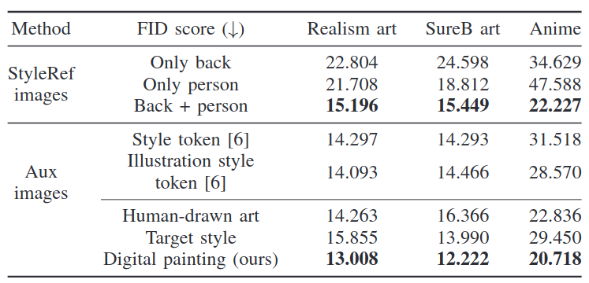

## Context

- Recent advancements in text-to-image models, such as Stable Diffusion, have demonstrated their ability to synthesize visual images through natural language prompts.
- [DreamBooth](https://arxiv.org/abs/2208.12242) is a recent method for personalizing a pre-trained text-to-image diffusion model, such as Stable Diffusion, using only a few images of a specific object, called instance images.
    - Using $3$–$5$ images of the specific object *(e.g., my dog)* paired with a text prompt *(e.g., "A [V] dog")* consisting of a unique token identifier *(e.g., "[V]")* representing the given object *(i.e., my dog)* and the corresponding class name *(e.g., "dog")*, DreamBooth fine-tunes a text-to-image diffusion model to encode the unique token with the subject.
    - To this end, DreamBooth introduces a class-specific prior preservation loss that encourages the fine-tuned model to keep semantic knowledge about the class prior *(i.e., "dog")* and produce diverse instances of the class *(e.g., various dogs)*.
- Loss proposed by DreamBooth:
    - $\mathbf{x}$: ground-truth image for the text prompt *(e.g., "A [V] dog")*
    - $\mathbf{c}$: conditioning vector *(e.g., obtained from "A [V] dog")*
    - $\epsilon, \epsilon'$: Gaussian noise
    - $\mathbf{x}_{\text{pr}}$: ground-truth image for the class prior *(e.g., "dog")*
    - $\mathbf{c}_{\text{pr}}$: conditioning vector for the class prior prompt *(e.g., obtained from "dog")*
    - $\alpha_t, \alpha_t', \sigma_t, \sigma_t', w_t, w_t'$: terms that control the noise schedule and sample quality

## Problem

- DreamBooth's personalization capabilities are excellent, especially for clear subjects like objects. However, learning to generate images that encapsulate various art styles remains a challenging problem due to the abstract and broad visual perceptions required for stylistic attributes such as lines, shapes, textures, and colors.
- In this paper, we aim to inherit DreamBooth's personalization abilities while effectively binding the abstract concept of **"art style."**
    - Instance prompt/images $\rightarrow$ StyleRef prompt/images
    - Class prior prompt/images $\rightarrow$ Aux prompt/images

## Proposed Method

- We hypothesize that DreamBooth struggles to learn abstract concepts for the following reasons:
    - The **StyleRef prompt (e.g., "A [V] style")** and the **Aux prompt (e.g., "style")** share the same token, and as a result, they influence each other during the learning process.
    - During learning, to prevent the Aux prompt *(e.g., "style")* from being lost, the Aux prompt is provided to generate images, and the corresponding token is re-learned. However, the pre-trained model has learned the Aux prompt as referring to fashion style, which is not useful for learning the target style.
- To address this, we propose the following method:
    - Aux images are carefully selected to represent artworks and people that are related to the target style, rather than fashion styles (high-resolution images).
        - Detailed descriptions of people *(e.g., hands, legs, face, and full-body shots)* remain important for qualitative evaluation, while landscapes or animal images are less sensitive. Therefore, Aux images mainly consist of portraits and/or images of people. This helps in generating high-quality images for people-related prompts.
    - Since learning a style from only $3$–$5$ images is difficult, we train with around $15$–$20$ images.
    - Our approach uses around $15$–$20$ images for both StyleRef and Aux images, establishing a foundational binding of the unique token identifier with a broad range of the target style. The Aux images are carefully chosen to strengthen this binding. This dual-binding strategy helps capture the essential concept of art styles and accelerates the learning of the diverse attributes of the target style.

Aux image ablation for three target styles, displaying FID and CLIP scores:

## Results

- Experimental evaluation on three styles — realism art, SureB art, and anime — demonstrates significant improvements in both the quality of generated images and perceptual fidelity metrics, such as FID and CLIP scores.
    - **"StyleRef"**: the composition of the target images should appropriately mix people and backgrounds to comprehensively understand the target style.
    - **"Aux"**: the Aux images should be composed in a style that can assist the target style.

