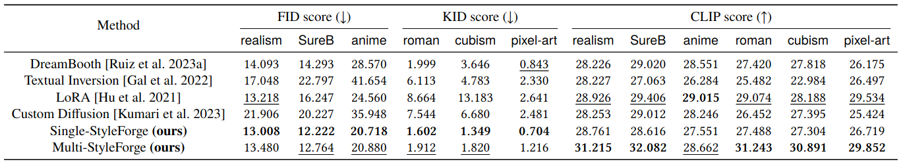

## Context

- Recent advancements in text-to-image models, such as Stable Diffusion, have demonstrated the ability to generate visual images from natural language prompts.
- This progress has also driven the development of personalization techniques for binding user inputs (e.g., images) to prompts, including methods like DreamBooth, Textual Inversion, and LoRA.
- However, these approaches struggle to capture arbitrary artistic styles due to the abstract and multifaceted nature of stylistic attributes.
- To reliably learn target styles, StyleBoost (equivalent to Single-StyleForge in this paper) proposes dual binding. It uses $15$–$20$ target style images to bind them to a unique token identifier while leveraging auxiliary images to ensure consistent representation of critical elements like people within the target style.
- StyleForge is an advanced version of [StyleBoost](/blog/styleboost/).

**Improvements in StyleForge over StyleBoost:**

- Validation of auxiliary images through heat maps, ensuring effectiveness and practicality.
- Introduction of Multi-StyleForge: instead of using a single unique token, it binds target and auxiliary images to multiple tokens, separating components like people and backgrounds.
- Broader experiments covering more target styles and baselines.

## Problem

- **StyleBoost (Single-StyleForge)** was proposed as a method to learn artistic styles, ensuring faithful image generation. However, it was found to lack strong text–image alignment capabilities.
- This paper introduces **Multi-StyleForge**, which improves text–image alignment while maintaining high image quality.

## Proposed Method

- While Single-StyleForge focuses on learning a comprehensive representation of the target style, Multi-StyleForge enhances this by dividing stylistic attributes into distinct components. This improves alignment between text prompts and generated images, especially for complex styles involving both backgrounds and people.
- Multi-StyleForge builds upon Single-StyleForge by mapping each stylistic component to a unique identifier.
- Single-StyleForge maps StyleRef images to a single prompt *(e.g., "[V] style")*, which often results in unintended inclusion of people in images when prompts lack person-related descriptions. Multi-StyleForge addresses this by introducing two StyleRef prompts *(e.g., "[V] style" for people and "[W] style" for backgrounds)*, training the model more effectively and reducing ambiguity.
- StyleRef images follow the Single-StyleForge structure, dividing target style elements into two parts: people and backgrounds. Each component is linked to a specific prompt *(e.g., "[V] style" for people, "[W] style" for backgrounds)*.
- As a result, Multi-StyleForge trains the model to distinguish stylistic features (people and backgrounds) and achieve separate embeddings.

## Results

### Experimental setting

- **Target styles**: Realism, SureB, Anime, Romanticism, Cubism, and Pixel-art
- **Baselines**: DreamBooth, Textual Inversion, LoRA, and Custom Diffusion
- **Evaluation metrics**: FID, KID, and CLIP scores

Attention maps for the "[V]" and "style" tokens in the prompt: "[V]" focuses on a broader area, while "style" focuses on people, aligning with the design intent.

![Attention maps of the [V] and style tokens](/assets/img/posts/styleforge_3.png)

### Main result

Quantitative comparisons with FID, KID ($\times 10^3$), and CLIP scores. The table presents FID scores for realism, SureB, and anime styles, along with KID scores for romanticism, cubism, and pixel-art styles, and CLIP scores for all styles. The best and second-best results are indicated in bold and underline, respectively.

